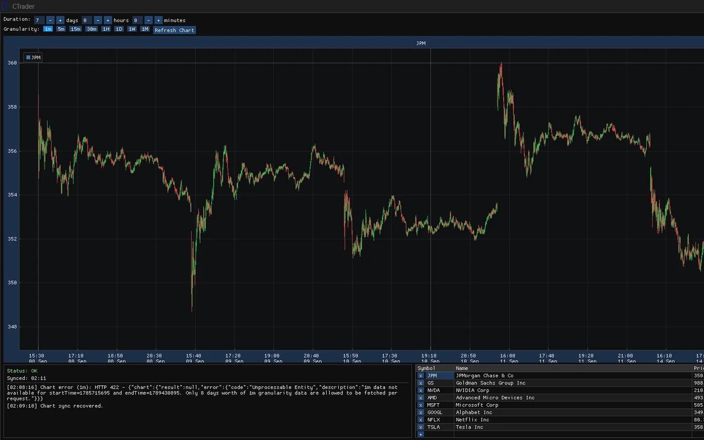
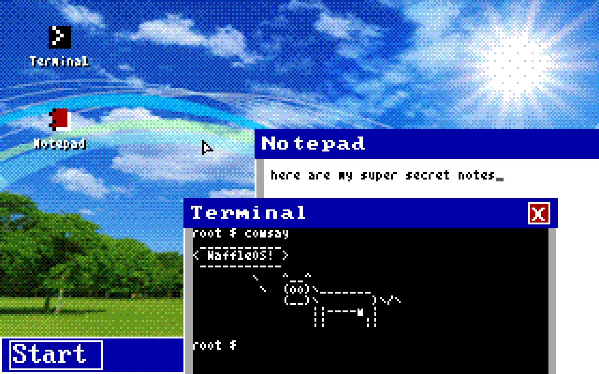
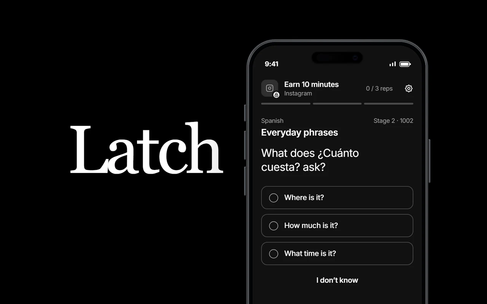
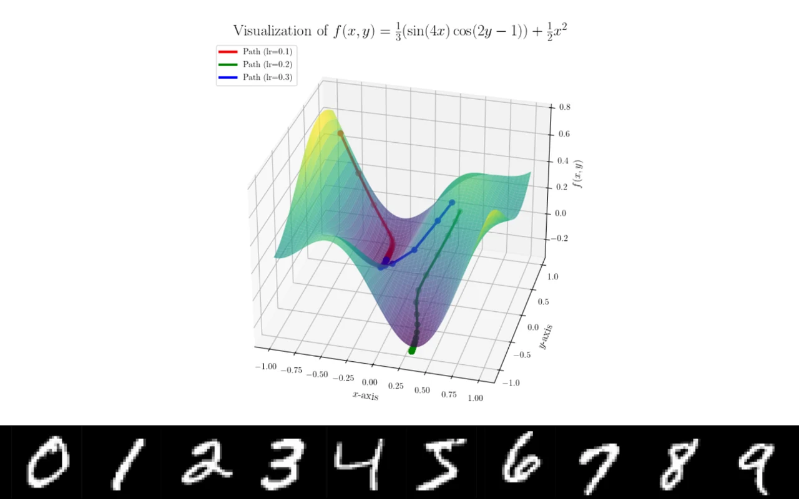

# Alan Smith

CS @ King's College London '29. I work on trading systems and low-level software.

Previously Head of Quant Dev at the [LU Ghosal Investment Fund](https://ghosal.fund/), where we built [GhosalQuant](https://github.com/Ghosal-Quants/GhosalQuant).

<table width="100%">
  <tr>
    <td colspan="2" align="right" valign="middle">
      <a href="https://alan-d-smith.github.io/" title="alan-d-smith.github.io"><picture><source media="(prefers-color-scheme: dark)" srcset="https://raw.githubusercontent.com/alan-d-smith/alan-d-smith/main/assets/icon-portfolio-dark.svg"></picture></a>&nbsp;
      &nbsp;
      <a href="https://codeforces.com/profile/alan-d-smith" title="Codeforces"><picture><source media="(prefers-color-scheme: dark)" srcset="https://raw.githubusercontent.com/alan-d-smith/alan-d-smith/main/assets/icon-codeforces-dark.svg"></picture></a>
    </td>
  </tr>
  <tr>
    <td width="50%" valign="top">
      
    </td>
    <td width="50%" valign="top">
      
    </td>
  </tr>
  <tr>
    <td width="50%" valign="top">
      
    </td>
    <td width="50%" valign="top">
      
    </td>
  </tr>
  <tr>
    <td colspan="2">
      <b>languages</b> 
      
      
      
      
      
      
    </td>
  </tr>
  <tr>
    <td colspan="2">
      <b>libraries</b> 
      
      
      
      
      
    </td>
  </tr>
</table>
